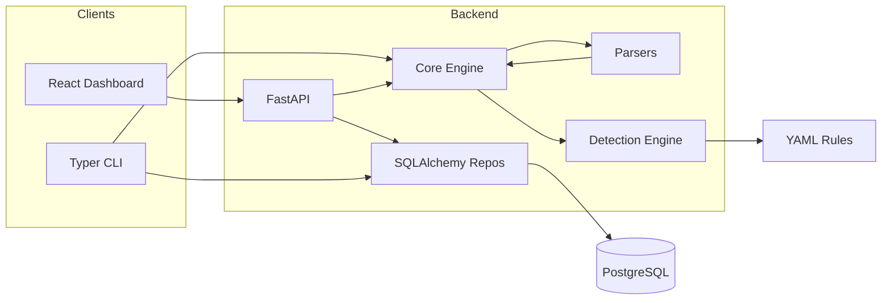

# Architecture

- **Single detection implementation**: `DetectionEngine` loads YAML from `backend/rules` and is invoked by `HuntService` (API/CLI) and `AnalyzeService` (CLI file-only mode).
- **Parsers** are independent of FastAPI; they yield `NormalizedEvent` models.
- **Ingestion** batches inserts with fingerprint-based deduplication.
